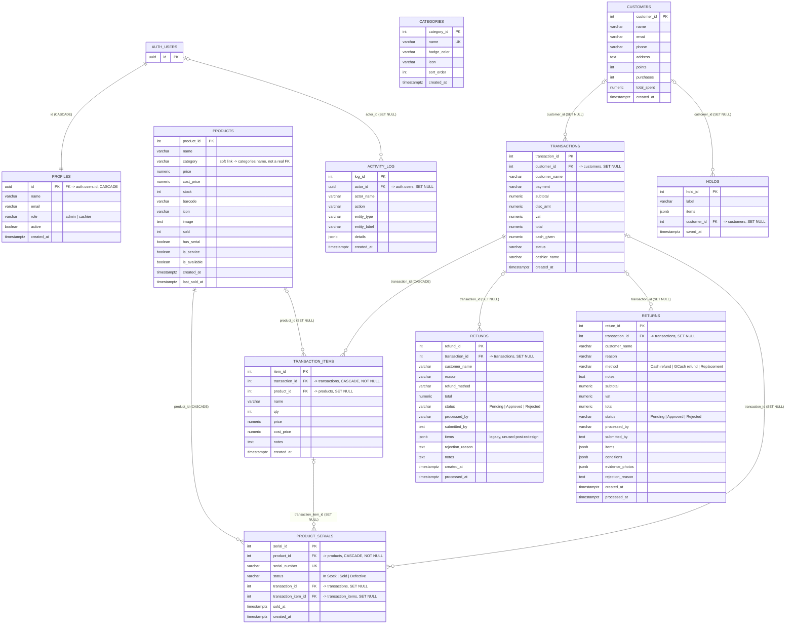

# Gapuz POS — Database ERD

Companion to `Database Data Dictionary.md` — same source (`supabase/schema.sql`
+ all 28 migrations, reconciled against `git log` for final state). This file
is just the relationships, as a Mermaid ER diagram plus a plain-text
breakdown of every foreign key and the one notable *non*-FK relationship.

`auth.users` is Supabase's built-in table (not defined in this repo's SQL) —
included here as a stub because two tables reference it.

---

## 1. Diagram

---

## 2. Every foreign key, plainly

| Child table.column | → Parent table.column | On delete | Required? |
|---|---|---|---|
| `profiles.id` | `auth.users.id` | CASCADE | required (it *is* the PK) |
| `activity_log.actor_id` | `auth.users.id` | SET NULL | optional |
| `transactions.customer_id` | `customers.customer_id` | SET NULL | optional (`Walk-in` sales have none) |
| `holds.customer_id` | `customers.customer_id` | SET NULL | optional |
| `transaction_items.transaction_id` | `transactions.transaction_id` | CASCADE | **required** |
| `transaction_items.product_id` | `products.product_id` | SET NULL | optional (product may be deleted later) |
| `product_serials.product_id` | `products.product_id` | CASCADE | **required** |
| `product_serials.transaction_id` | `transactions.transaction_id` | SET NULL | optional (NULL until sold) |
| `product_serials.transaction_item_id` | `transaction_items.item_id` | SET NULL | optional (NULL until sold) |
| `refunds.transaction_id` | `transactions.transaction_id` | SET NULL | optional |
| `returns.transaction_id` | `transactions.transaction_id` | SET NULL | optional |

**Why so many `SET NULL`s instead of `CASCADE` or `RESTRICT`:** this is a sales-history system — deleting a `product` or a `customer` must never cascade into deleting the `transactions`/`refunds`/`returns` that already happened. Only genuinely dependent rows (`transaction_items` under their `transaction`, `product_serials` under their `product`) cascade.

---

## 3. Relationships that are *not* real foreign keys

- **`products.category` ↔ `categories.name`** — plain string match, no `REFERENCES` constraint. A category can be renamed in `categories` without updating every `products.category` that used the old name, and a product's `category` can contain a string that doesn't exist in `categories` at all (nothing stops it). This is why `products.is_service` was introduced as a real boolean instead of string-comparing `category === 'Services'` everywhere.
- **`refunds`/`returns` → line-item detail** — neither table has an FK to `transaction_items` or `products`. A return's affected lines live in its own `items jsonb` column (`[{item_id, product_id, qty, serials:[...]}]`), validated against `transaction_items` *at insert time* by `create_return()`, then frozen as a snapshot — later edits to the product or even deletion of the transaction (`SET NULL`) don't retroactively change what a past return recorded.

---

## 4. Cardinality cheat-sheet (plain English)

- One **customer** → many **transactions**, many **holds** (or zero of either; walk-in sales/holds have no customer).
- One **transaction** → many **transaction_items** (always ≥1 in practice, not DB-enforced), zero-or-more **refunds**, zero-or-more **returns**, zero-or-more **product_serials** (only for lines that were serialized).
- One **product** → many **product_serials** (only if `has_serial`), referenced by many **transaction_items** over its lifetime (or none, if never sold/deleted from a sale).
- One **transaction_item** → zero-or-more **product_serials** (one per unit, only for a serialized line's qty).
- One **auth user** → exactly one **profile**, and zero-or-more **activity_log** entries as actor.
